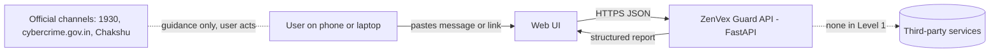
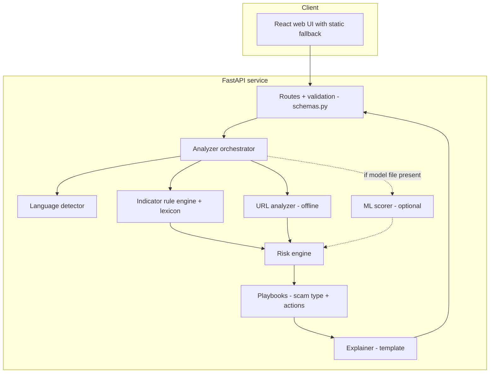
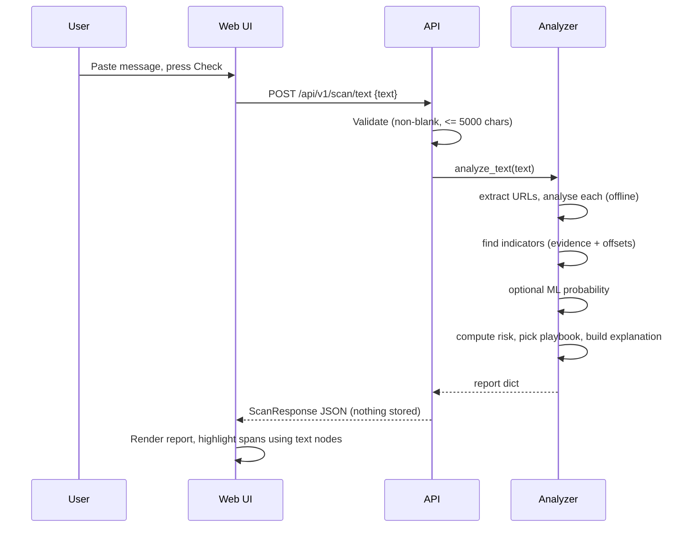
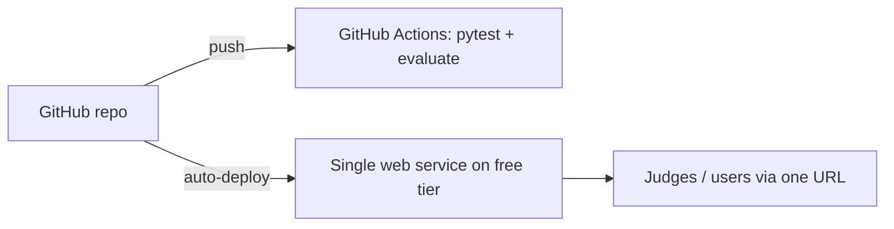

# High-Level Design (HLD)

ZenVex Guard – Level 1 prototype. Status of each part is marked **[built]**, **[planned L2]** or **[optional]**.

## 1. Purpose and scope

Help an ordinary user decide whether a message or link is a scam *before acting on it*, by showing evidence and safe next steps in plain language (English plus Telugu action steps).

**In scope (Level 1, built):** text scanning, language detection, rule-based indicators, offline URL analysis, risk scoring, scam-type playbooks, deterministic explanation, REST API, web UI, tests, evaluation script.

**Out of scope until Level 2:** screenshot OCR, trained ML model in the live path, history/feedback storage, LLM-phrased explanations, URL reputation lookups, SMS/WhatsApp integration, browser extension.

## 2. Users and key scenarios

| User | Scenario | Success |
|---|---|---|
| Everyday smartphone user | Pastes a KYC/OTP message | Sees risk band, matched phrases, what to do |
| Telugu-speaking user | Pastes Telugu or Romanised Telugu text | Language recognised; Telugu action steps shown |
| Cautious user | Pastes only a link | Gets structural findings, never a "safe" claim |
| Victim who already paid | Reads report | Sees 1930 / cybercrime.gov.in guidance prominently |

## 3. Context diagram

The default path makes **no calls to third parties** and **stores nothing**.

## 4. Component view

| Component | Responsibility | Status |
|---|---|---|
| Web UI | Input, highlighted message, report, language toggle | built |
| Routes + validation | Request limits, response contract | built |
| Language detector | Script ranges and marker words: en, te, hi, te-rom, hi-rom, mixed | built |
| Indicator engine | 12 indicators with evidence and offsets | built |
| URL analyzer | 14 structural checks, no network | built |
| ML scorer | TF-IDF + logistic regression, up to 20 points | optional, off without a model file |
| Risk engine | Text points + capped URL points + optional ML points, banded | built |
| Playbooks | 9 named scam types with specific safe actions | built |
| Explainer | Sentences built only from findings | built |
| OCR service | Screenshot to text | planned L2 |
| History/feedback store | Opt-in, minimal | planned L2 |

## 5. Data flow (text scan)

## 6. Technology choices (summary)

FastAPI + Pydantic, plain-Python rule engine, optional scikit-learn, static HTML/JS UI now and React in Level 2, single free-tier web service. Reasons and alternatives are in `TECH_STACK_DECISION.md`.

## 7. Deployment view

One web service runs `uvicorn app.main:app`; it serves the API and the static UI from the same origin (no CORS problem, one URL for judges). `render.yaml` describes it. CI (GitHub Actions) runs tests and the evaluation script on every push.

## 8. Non-functional requirements

| Area | Target | How |
|---|---|---|
| Privacy | No message stored or logged | Stateless API, no DB in L1, tests check no scan retrieval |
| Safety | Server never fetches user URLs | Offline analyzer; test blocks sockets |
| Honesty | No "safe" verdicts; scores are not probabilities | Verdict vocabulary, disclaimer in every response |
| Performance | Typical scan well under a second | Pure-Python regex, no network |
| Reliability | Works with no external service | Deterministic explainer; ML fails soft |
| Accessibility | Keyboard focus, light/dark, mobile layout | UI CSS |
| Maintainability | Modular, tested, contract-first | Schemas + API contract + tests |

## 9. Trust boundaries and threats

| Threat | Mitigation |
|---|---|
| SSRF via submitted URL | URLs are never fetched or resolved |
| XSS via pasted text | UI uses text nodes/`textContent`, never `innerHTML` |
| Oversized input / abuse | 5000-character text limit, 2048-character URL limit; add rate limiting on the host if exposed publicly |
| ReDoS on regex | Patterns use bounded windows (`.{0,N}`); add timeouts/fuzz tests in L2 |
| Overclaiming | Wording rules in `AGENTS.md`; limitations documented |
| Data leakage to third parties | None in default path; future adapters must be opt-in and send minimal data (domain only) |

## 10. Key risks

| Risk | Impact | Response |
|---|---|---|
| Small, self-written evaluation set | Metrics look better than reality | Build separate held-out set; report limitations (see test plan) |
| Rule coverage gaps | Missed new scams | Lexicon maintenance, feedback loop in L2, ML ablation |
| Telugu/Hindi wording errors | Wrong or awkward output | Native-speaker review before demo |
| Incomplete official-domain list | Genuine domain shown as possible impersonation | Wording says "possible"; extend and verify the list |
| Free-tier cold starts | Slow first load in demo | Open the app a few minutes before judging |

## 11. Evolution path (Level 2, 48 hours)

1. Freeze scope after the challenge brief; keep the demo path stable.
2. Expand and publish the evaluation set; run the rules-vs-ML ablation.
3. Add OCR (screenshot to text, then the same pipeline).
4. Replace the static UI with React only if the core is stable.
5. Add opt-in feedback storage (SQLite first).
6. Optional LLM phrasing of the explanation using structured findings only.

